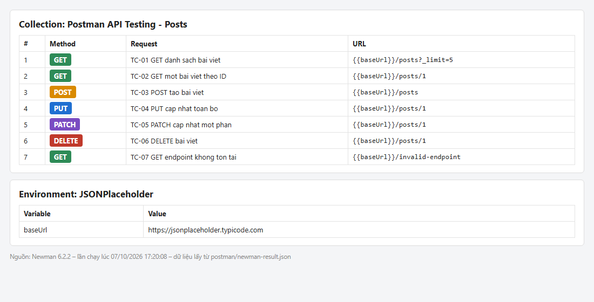
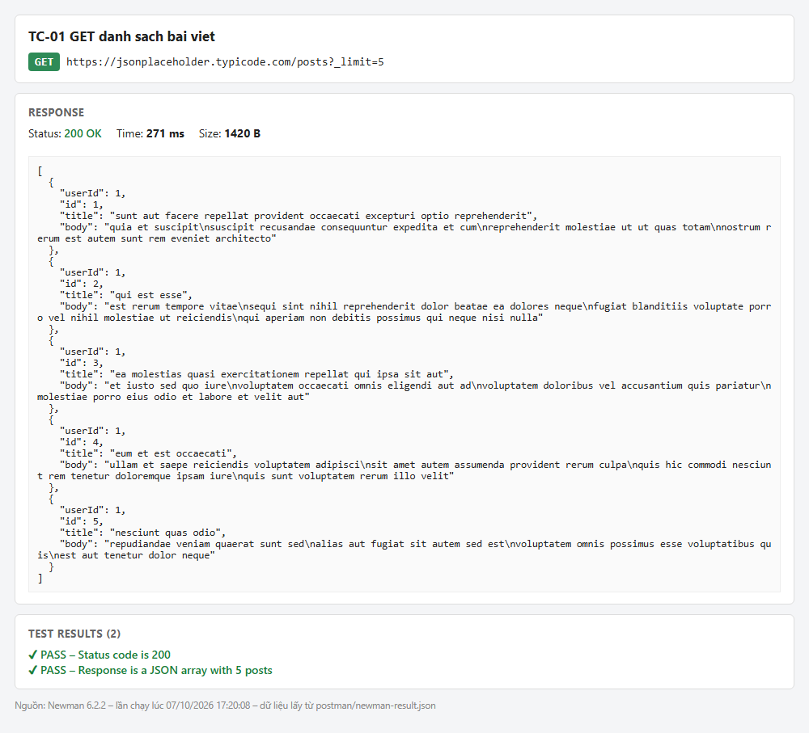
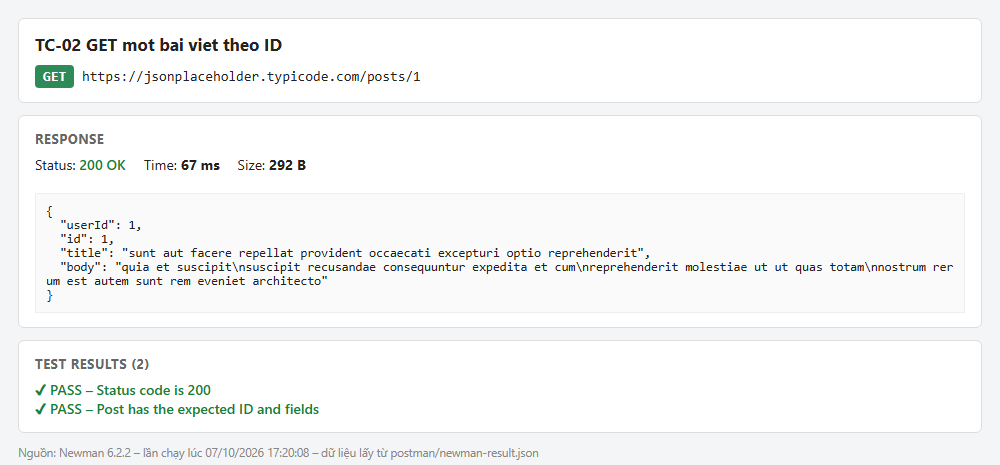
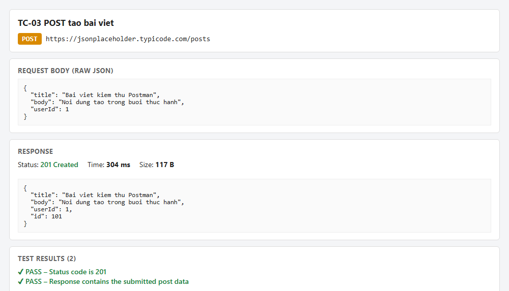
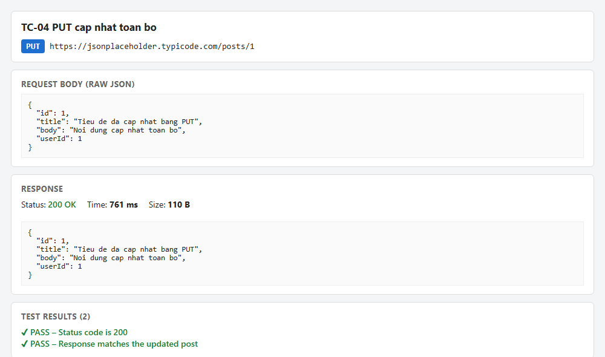
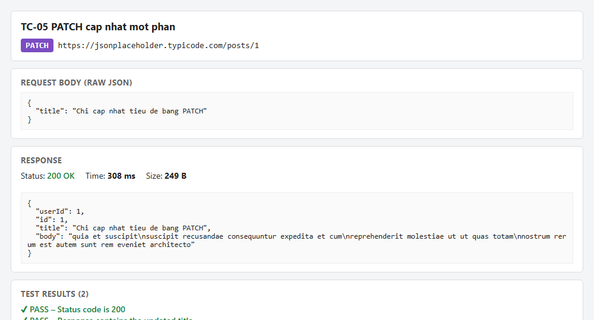
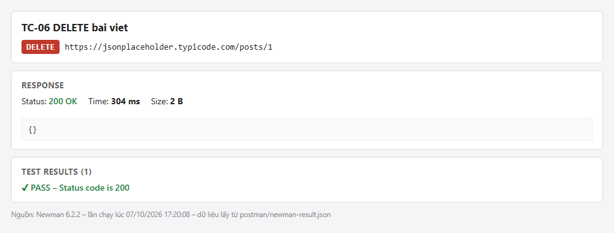
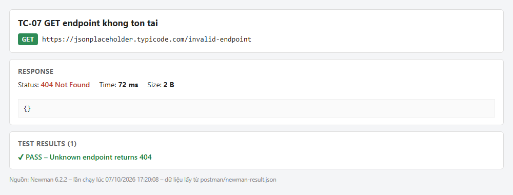
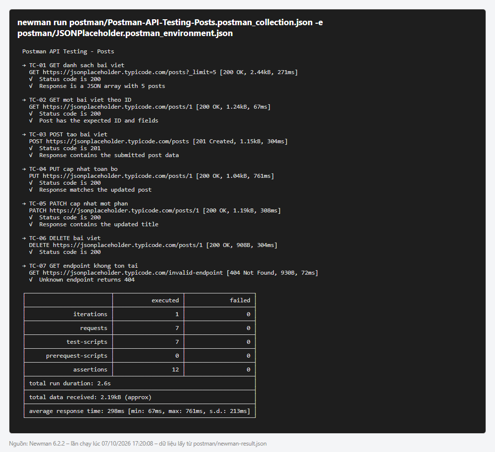
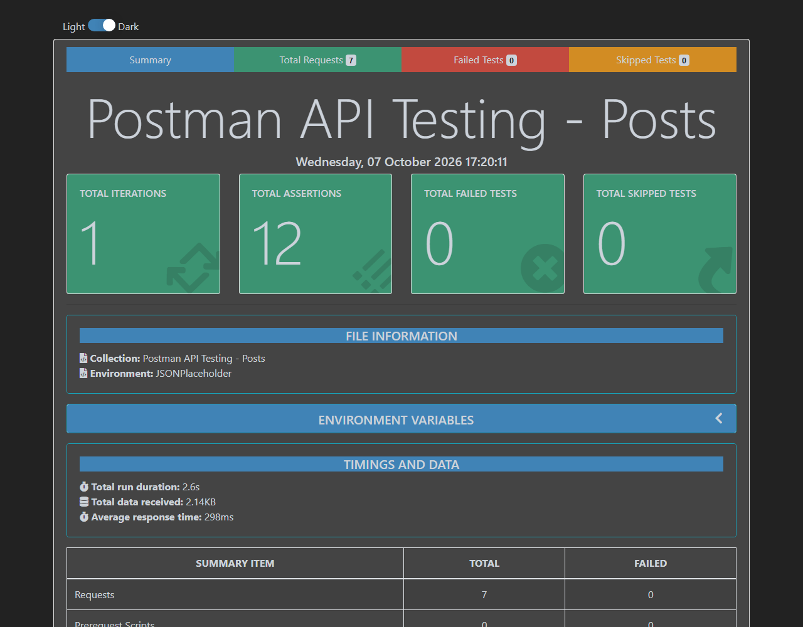

# BÁO CÁO THỰC HÀNH KIỂM THỬ API BẰNG POSTMAN

## Thông tin bài thực hành

| Nội dung | Thông tin |
|---|---|
| Họ và tên | `Đoàn Văn Khánh` |
| Mã sinh viên / Lớp | `23010252` |
| Ngày thực hiện | 07/10/2026 |
| Công cụ | Postman Collection v2.1 + Newman 6.2.2 (trình chạy collection dòng lệnh của Postman), Node.js 22.11.0 |
| Đề tài | Làm quen với Postman và kiểm thử REST API |

## 1. Mục tiêu

- Làm quen với giao diện và quy trình gửi HTTP request trong Postman.
- Thực hành các phương thức `GET`, `POST`, `PUT`, `PATCH`, `DELETE`.
- Biết cách cấu hình URL, query parameter, header, request body và environment variable.
- Viết kiểm tra tự động bằng tab **Scripts > Post-response** (hoặc **Tests** ở một số phiên bản).
- Chạy nhiều request bằng **Collection Runner** (Newman), đọc kết quả và ghi nhận lỗi.

## 2. Tài liệu học tập

1. Video theo yêu cầu bài tập: [Học công cụ kiểm thử Postman](https://www.youtube.com/watch?v=MFxk5BZulVU).
2. Tài liệu chính thức: [Postman Learning Center](https://learning.postman.com/).
3. Hướng dẫn viết test script: [Write scripts and tests](https://learning.postman.com/docs/tests-and-scripts/write-scripts/test-scripts/).
4. Hướng dẫn chạy collection bằng dòng lệnh: [Newman](https://learning.postman.com/docs/collections/using-newman-cli/command-line-integration-with-newman/).
5. Hai báo cáo tham khảo:
   - [New-Collection-of-APIs](https://github.com/gtaAsian/New-Collection-of-APIs/tree/main): tham khảo cách trình bày từng kịch bản (tên, mục đích, phương thức, URL, tham số, kết quả mong đợi / thực tế, trạng thái), phần tổng hợp tỉ lệ thành công và phần phát hiện lỗi.
   - [CallPostMan](https://github.com/quocbinh93/CallPostMan): tham khảo phần giới thiệu Postman, các yêu cầu GET/POST/PUT/DELETE, viết Test và dùng biến để lưu URL.

### Ghi chú học tập

- **Postman dùng để làm gì?**
  Postman là công cụ để tạo, gửi và kiểm thử các HTTP request tới API. Công cụ cho phép xem status code, header, body của response, viết script kiểm tra tự động, gom request vào Collection, quản lý biến theo Environment và chạy hàng loạt bằng Collection Runner / Newman.
- **Request gồm những thành phần nào?**
  Method (`GET`, `POST`, `PUT`, `PATCH`, `DELETE`…), URL (base URL + path), Params (query string như `_limit=5`), Headers (ví dụ `Content-Type: application/json`), Body (raw JSON khi gửi dữ liệu), Authorization (nếu API cần xác thực) và Scripts (Pre-request / Post-response).
- **Bạn đã học được thao tác hoặc tính năng nào mới?**
  - Dùng Environment variable `{{baseUrl}}` để không phải lặp lại địa chỉ máy chủ trong từng request.
  - Viết assertion bằng `pm.test()` và `pm.expect()` để kiểm tra status code và nội dung JSON.
  - Xuất collection ra file JSON và chạy tự động bằng Newman, tạo báo cáo HTML.
  - Phân biệt `PUT` (thay toàn bộ tài nguyên) và `PATCH` (chỉ cập nhật một phần).
- **Phần nào còn chưa rõ?**
  `[Ghi câu hỏi của bạn hoặc “Không còn câu hỏi”]`

## 3. Môi trường và API thực hành

- **Ứng dụng:** Postman (định dạng Collection v2.1); collection được chạy bằng Newman 6.2.2 trên Windows 11.
- **API:** [JSONPlaceholder](https://jsonplaceholder.typicode.com/), API công khai phục vụ mục đích thử nghiệm.
- **Base URL:** `https://jsonplaceholder.typicode.com`
- **Đối tượng:** `/posts`
- **Xác thực:** Không cần token cho các request trong bài này.
- **Phương pháp kiểm thử:** kiểm thử chức năng hộp đen; mỗi request có script Post-response kiểm tra tự động (status code + nội dung response), chạy toàn bộ collection một lượt.

> JSONPlaceholder mô phỏng các thao tác ghi dữ liệu. `POST`, `PUT`, `PATCH` và `DELETE` trả về response minh họa nhưng không lưu thay đổi thật; vì vậy không dùng việc đọc lại dữ liệu để kết luận thao tác ghi đã được lưu.

## 4. Chuẩn bị Postman

Các file đã tạo nằm trong thư mục [postman/](postman/) và có thể **Import** trực tiếp vào Postman:

| File | Nội dung |
|---|---|
| [Postman-API-Testing-Posts.postman_collection.json](postman/Postman-API-Testing-Posts.postman_collection.json) | Collection `Postman API Testing - Posts` gồm 7 request kèm test script |
| [JSONPlaceholder.postman_environment.json](postman/JSONPlaceholder.postman_environment.json) | Environment `JSONPlaceholder` với biến `baseUrl` |
| [newman-report.html](postman/newman-report.html) | Báo cáo HTML của lần chạy (mở bằng trình duyệt) |
| [newman-result.json](postman/newman-result.json) | Kết quả chi tiết dạng JSON (request, response, assertion) |
| [newman-cli-output.txt](postman/newman-cli-output.txt) | Log của lần chạy |

1. Environment `JSONPlaceholder`:

   | Variable | Initial value | Current value |
   |---|---|---|
   | `baseUrl` | `https://jsonplaceholder.typicode.com` | `https://jsonplaceholder.typicode.com` |

2. Collection `Postman API Testing - Posts`; mọi request đều dùng URL dạng `{{baseUrl}}/...`.
3. Với request có JSON body, chọn **Body > raw > JSON** và header `Content-Type: application/json`.



## 5. Kịch bản kiểm thử

| ID | Tên kịch bản | Request | Dữ liệu / URL | Kết quả mong đợi | Kết quả thực tế / Trạng thái |
|---|---|---|---|---|---|
| TC-01 | Lấy danh sách bài viết | `GET` | `{{baseUrl}}/posts?_limit=5` | HTTP `200`; response là mảng JSON có 5 phần tử | `200 OK`, mảng 5 bài viết (271 ms) — ✅ **Passed** |
| TC-02 | Lấy một bài viết theo ID | `GET` | `{{baseUrl}}/posts/1` | HTTP `200`; response có `id = 1`, `title` và `body` | `200 OK`, `id = 1`, có `title`, `body` (67 ms) — ✅ **Passed** |
| TC-03 | Tạo bài viết mô phỏng | `POST` | `{{baseUrl}}/posts` | HTTP `201`; response chứa `title`, `body`, `userId` đã gửi và có `id` | `201 Created`, trả lại đúng dữ liệu gửi, `id = 101` (304 ms) — ✅ **Passed** |
| TC-04 | Cập nhật toàn bộ bài viết | `PUT` | `{{baseUrl}}/posts/1` | HTTP `200`; response phản ánh nội dung gửi lên | `200 OK`, `title`/`body`/`userId` khớp dữ liệu gửi (761 ms) — ✅ **Passed** |
| TC-05 | Cập nhật một phần bài viết | `PATCH` | `{{baseUrl}}/posts/1` | HTTP `200`; response phản ánh trường `title` mới | `200 OK`, `title` mới, các trường khác giữ nguyên (308 ms) — ✅ **Passed** |
| TC-06 | Xóa bài viết mô phỏng | `DELETE` | `{{baseUrl}}/posts/1` | HTTP `200`; request hoàn tất thành công | `200 OK`, body `{}` (304 ms) — ✅ **Passed** |
| TC-07 | Truy vấn endpoint không tồn tại | `GET` | `{{baseUrl}}/invalid-endpoint` | HTTP `404` | `404 Not Found`, body `{}` (72 ms) — ✅ **Passed** |

### Chi tiết từng kịch bản

#### TC-01 — GET danh sách

- **Mục đích:** kiểm tra lấy danh sách bài viết có giới hạn số lượng bằng query parameter.
- Method: `GET` — URL: `{{baseUrl}}/posts` — Params: `_limit = 5`
- Script Post-response:

```javascript
pm.test("Status code is 200", function () {
    pm.response.to.have.status(200);
});

pm.test("Response is a JSON array with 5 posts", function () {
    const data = pm.response.json();
    pm.expect(data).to.be.an("array").with.lengthOf(5);
});
```

- **Kết quả thực tế:** `200 OK`, response là mảng 5 phần tử (id 1–5). 2/2 assertion pass.



#### TC-02 — GET một bài viết

- **Mục đích:** kiểm tra lấy chi tiết một tài nguyên theo ID trên path.
- Method: `GET` — URL: `{{baseUrl}}/posts/1`
- Script:

```javascript
pm.test("Status code is 200", function () {
    pm.response.to.have.status(200);
});

pm.test("Post has the expected ID and fields", function () {
    const data = pm.response.json();
    pm.expect(data.id).to.eql(1);
    pm.expect(data.title).to.be.a("string").and.not.empty;
    pm.expect(data.body).to.be.a("string").and.not.empty;
});
```

- **Kết quả thực tế:** `200 OK`, object có `userId`, `id = 1`, `title`, `body` không rỗng. 2/2 assertion pass.



#### TC-03 — POST tạo bài viết mô phỏng

- **Mục đích:** kiểm tra tạo mới tài nguyên với body JSON.
- Method: `POST` — URL: `{{baseUrl}}/posts` — Header: `Content-Type: application/json`
- Body:

```json
{
  "title": "Bai viet kiem thu Postman",
  "body": "Noi dung tao trong buoi thuc hanh",
  "userId": 1
}
```

- Script:

```javascript
pm.test("Status code is 201", function () {
    pm.response.to.have.status(201);
});

pm.test("Response contains the submitted post data", function () {
    const data = pm.response.json();
    pm.expect(data.title).to.eql("Bai viet kiem thu Postman");
    pm.expect(data.body).to.eql("Noi dung tao trong buoi thuc hanh");
    pm.expect(data.userId).to.eql(1);
    pm.expect(data.id).to.exist;
});
```

- **Kết quả thực tế:** `201 Created`, response trả lại đúng 3 trường đã gửi và thêm `"id": 101`. 2/2 assertion pass.



#### TC-04 — PUT cập nhật toàn bộ

- **Mục đích:** kiểm tra thay thế toàn bộ nội dung một tài nguyên.
- Method: `PUT` — URL: `{{baseUrl}}/posts/1`
- Body:

```json
{
  "id": 1,
  "title": "Tieu de da cap nhat bang PUT",
  "body": "Noi dung cap nhat toan bo",
  "userId": 1
}
```

- Script:

```javascript
pm.test("Status code is 200", function () {
    pm.response.to.have.status(200);
});

pm.test("Response matches the updated post", function () {
    const data = pm.response.json();
    pm.expect(data.title).to.eql("Tieu de da cap nhat bang PUT");
    pm.expect(data.body).to.eql("Noi dung cap nhat toan bo");
    pm.expect(data.userId).to.eql(1);
});
```

- **Kết quả thực tế:** `200 OK`, response khớp toàn bộ dữ liệu gửi lên. 2/2 assertion pass.



#### TC-05 — PATCH cập nhật một phần

- **Mục đích:** kiểm tra chỉ cập nhật trường `title`, các trường còn lại giữ nguyên.
- Method: `PATCH` — URL: `{{baseUrl}}/posts/1`
- Body:

```json
{
  "title": "Chi cap nhat tieu de bang PATCH"
}
```

- Script:

```javascript
pm.test("Status code is 200", function () {
    pm.response.to.have.status(200);
});

pm.test("Response contains the updated title", function () {
    pm.expect(pm.response.json().title)
        .to.eql("Chi cap nhat tieu de bang PATCH");
});
```

- **Kết quả thực tế:** `200 OK`, `title` đã đổi, `userId`, `id`, `body` giữ giá trị gốc của bài viết 1. 2/2 assertion pass.



#### TC-06 — DELETE

- **Mục đích:** kiểm tra xóa một tài nguyên.
- Method: `DELETE` — URL: `{{baseUrl}}/posts/1`
- Script:

```javascript
pm.test("Status code is 200", function () {
    pm.response.to.have.status(200);
});
```

- **Kết quả thực tế:** `200 OK`, body rỗng `{}`. 1/1 assertion pass.



#### TC-07 — Kiểm tra lỗi 404

- **Mục đích:** kiểm thử trường hợp âm (negative test) — gọi endpoint không tồn tại.
- Method: `GET` — URL: `{{baseUrl}}/invalid-endpoint`
- Script:

```javascript
pm.test("Unknown endpoint returns 404", function () {
    pm.response.to.have.status(404);
});
```

- **Kết quả thực tế:** `404 Not Found`, body `{}`. 1/1 assertion pass — API xử lý đúng đường dẫn sai.



## 6. Chạy và ghi nhận kết quả

Toàn bộ collection được chạy một lượt bằng Newman (tương đương **Run collection** trong Postman) với lệnh:

```bash
newman run postman/Postman-API-Testing-Posts.postman_collection.json \
  -e postman/JSONPlaceholder.postman_environment.json \
  -r cli,json,htmlextra \
  --reporter-json-export postman/newman-result.json \
  --reporter-htmlextra-export postman/newman-report.html
```





### Tổng hợp kết quả

| Tổng số kịch bản | Passed | Failed | Bỏ qua | Tỉ lệ thành công |
|---:|---:|---:|---:|---:|
| 7 | 7 | 0 | 0 | 100% |

| Chỉ số | Giá trị |
|---|---|
| Số request đã gửi | 7 (0 lỗi) |
| Số assertion | 12 (12 pass, 0 fail) |
| Tổng thời gian chạy | 2.6 s |
| Thời gian phản hồi trung bình | 298 ms (min 67 ms, max 761 ms) |

**Nhận xét kết quả:** Cả 7 kịch bản đều cho kết quả thực tế khớp với kết quả mong đợi. Các thao tác đọc (TC-01, TC-02) trả đúng số lượng và cấu trúc dữ liệu; các thao tác ghi (TC-03 → TC-06) trả đúng status code và phản hồi lại dữ liệu đã gửi; trường hợp âm TC-07 trả đúng `404`. Request chậm nhất là `PUT` (761 ms), vẫn ở mức chấp nhận được với một API công khai.

### Phát hiện lỗi / ghi chú

- **Không phát hiện lỗi** trong phạm vi 7 kịch bản.
- **Ghi chú 1:** `POST` luôn trả về `id = 101` và dữ liệu không được lưu thật; đây là hành vi được JSONPlaceholder mô tả (API giả lập), không phải lỗi.
- **Ghi chú 2:** TC-07 là kiểm thử âm — status `404` là kết quả *mong đợi* nên được tính là Passed (khác với báo cáo tham khảo New-Collection-of-APIs, nơi lỗi 404 do sai URL được tính là kịch bản thất bại).

## 7. Bằng chứng thực hành

Ảnh được chụp từ lần chạy thật lúc 17:20 ngày 07/10/2026 và lưu trong thư mục [images/](images/). Ảnh từng request được dựng từ dữ liệu request/response/assertion ghi trong `postman/newman-result.json`; ảnh tổng quan là trang Summary của báo cáo HTML do Newman (htmlextra) sinh ra.

| Nội dung cần minh chứng | Ảnh |
|---|---|
| Collection và các request đã tạo |  |
| TC-01 — GET danh sách bài viết |  |
| TC-02 — GET một bài viết theo ID |  |
| TC-03 — POST tạo bài viết |  |
| TC-04 — PUT cập nhật toàn bộ |  |
| TC-05 — PATCH cập nhật một phần |  |
| TC-06 — DELETE bài viết |  |
| TC-07 — GET endpoint không tồn tại (404) |  |
| Kết quả chạy collection và test assertions |  |
| Báo cáo HTML tổng hợp |  |

## 8. Kết luận và tự đánh giá

- **Điều đã thực hiện được:** Tạo Environment `JSONPlaceholder` và Collection 7 request bao phủ đủ 5 phương thức `GET`, `POST`, `PUT`, `PATCH`, `DELETE` cùng một kịch bản âm (404); viết 12 assertion tự động; chạy toàn bộ collection, xuất báo cáo HTML/JSON. Kết quả 7/7 kịch bản Passed.
- **Điều học được về Postman/API testing:** Cách tổ chức request trong Collection, tái sử dụng biến môi trường, viết test với `pm.test`/`pm.expect`, phân biệt ý nghĩa các status code `200`, `201`, `404`, và chạy collection tự động bằng dòng lệnh để có thể tích hợp vào CI.
- **Khó khăn gặp phải và cách xử lý:** JSONPlaceholder không lưu dữ liệu ghi, nên không thể kiểm tra bằng cách `GET` lại sau khi `POST`/`PUT`; cách xử lý là kiểm tra trực tiếp nội dung response của chính request ghi.
- **Hướng thực hành tiếp theo:** Thêm kiểm tra header (`Content-Type`), giới hạn thời gian phản hồi (`pm.response.responseTime`), JSON schema; dùng biến động (lưu `id` từ response POST cho request sau); thực hành với API có xác thực (Bearer token / API key); chạy collection với file dữ liệu (data-driven testing).

